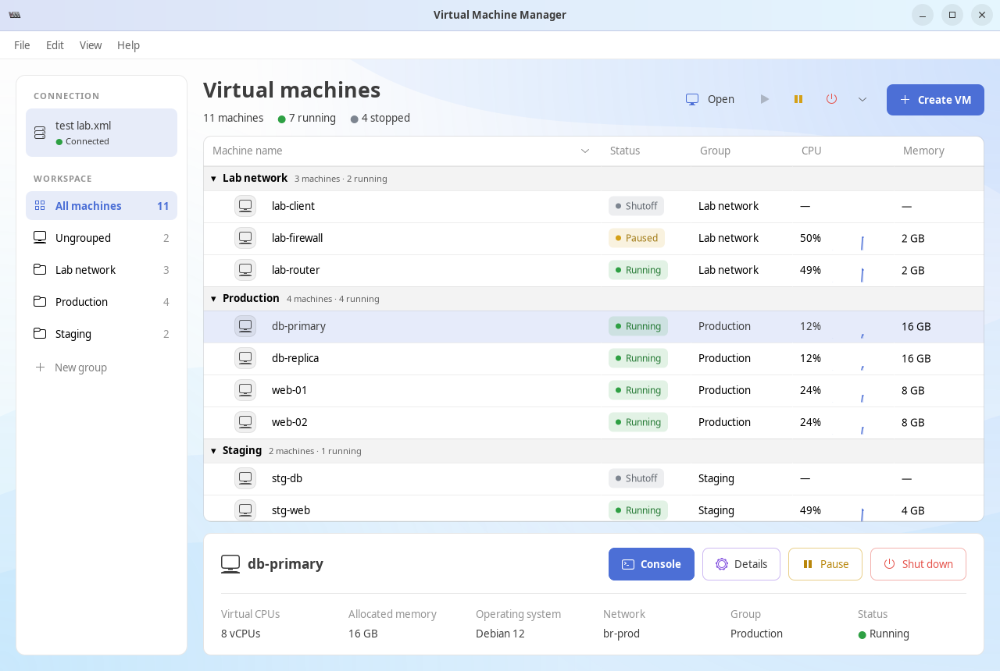

# Virtual Machine Manager

`virt-manager` is a graphical tool for managing virtual machines
via [libvirt](https://libvirt.org). Most usage is with QEMU/KVM
virtual machines, but Xen and libvirt LXC containers are well
supported. Common operations for any libvirt driver should work.



This fork reworks the main window around VM groups:

 - **Groups**: organize the VMs of a connection into named groups, for
   example one per network setup, and run or shut down a whole group
   at once
 - **Sidebar**: switch between all machines, the ungrouped ones, or a
   single group
 - **Machine table**: machines listed under collapsible group headings,
   with status, CPU and memory at a glance and a detail card for the
   selected VM
 - **Refreshed look**: the same styling carried through the VM window,
   wizards and dialogs

Several command line tools are also provided:

 - `virt-install`: Create new libvirt virtual machines
 - `virt-clone`: Duplicate existing libvirt virtual machines
 - `virt-xml`: Edit existing libvirt virtual machines/manipulate libvirt XML

## Installing this fork on Ubuntu

The `virt-manager` package in the Ubuntu repositories is the upstream
version and does not have these changes, so this fork has to be
installed from source. The steps below were written for Ubuntu 24.04;
they should work the same on other recent Ubuntu and Debian releases.

### 1. Install libvirt and QEMU

Skip this if the machine already runs virtual machines.

```sh
sudo apt update
sudo apt install qemu-system-x86 libvirt-daemon-system libvirt-clients
sudo usermod -aG libvirt "$USER"
```

Log out and back in so that the new group membership applies, then
check that libvirt answers:

```sh
virsh -c qemu:///system list --all
```

### 2. Install the dependencies

```sh
sudo apt install git meson gettext python3-docutils libglib2.0-bin \
    python3-gi python3-gi-cairo python3-libvirt python3-libxml2 \
    python3-requests python3-argcomplete xorriso \
    gir1.2-gtk-3.0 gir1.2-libvirt-glib-1.0 gir1.2-libosinfo-1.0 \
    gir1.2-gtk-vnc-2.0 gir1.2-spiceclientgtk-3.0 gir1.2-vte-2.91 \
    gir1.2-gtksource-4 gir1.2-ayatanaappindicator3-0.1
```

### 3. Get the source

```sh
git clone https://github.com/ArunEG/virt-manager.git
cd virt-manager
```

### 4a. Run it without installing

Nothing needs to be built to try it out. From the checkout:

```sh
./virt-manager
```

Add `--debug` to see log output in the terminal. This is the easiest
way to stay up to date: `git pull` and start it again.

### 4b. Or install it system wide

If the Ubuntu package is installed, remove it first so that the two
do not get mixed up. Your VMs and connections are not affected:

```sh
sudo apt remove virt-manager
```

Then build and install into `/usr/local`:

```sh
meson setup build -Dtests=disabled
sudo meson install -C build
```

`virt-manager` now shows up in the applications menu and can be
started from a terminal with `virt-manager`. The command line tools
`virt-install`, `virt-clone` and `virt-xml` are installed alongside.

To update later:

```sh
git pull
sudo meson install -C build
```

To remove it again:

```sh
sudo ninja -C build uninstall
```

### Troubleshooting

 - **`ValueError: Namespace ... not available`**: one of the `gir1.2-*`
   packages from step 2 is missing.
 - **"Unable to connect to libvirt qemu:///system"**: your user is not
   in the `libvirt` group yet (log out and in after step 1), or the
   service is not running: `sudo systemctl enable --now libvirtd`.
 - **The old window still opens**: another `virt-manager` is already
   running, or `/usr/bin/virt-manager` from the Ubuntu package is found
   first. Close the running instance and check `which virt-manager`.

Groups are stored in your desktop settings (dconf), not in libvirt, so
they belong to your user on this machine and the VMs themselves are
never modified.

More background on dependencies is in [INSTALL.md](INSTALL.md).

## Contact

 - For IRC we use #virt on OFTC.
 - For bug reporting info, see
   [virt-manager bug reporting](https://virt-manager.org/bugs).
 - There are further project details on the
   [virt-manager](https://virt-manager.org/) website.
 - See the [CONTRIBUTING.md](CONTRIBUTING.md) file for info about submitting patches or
   contributing translations.
